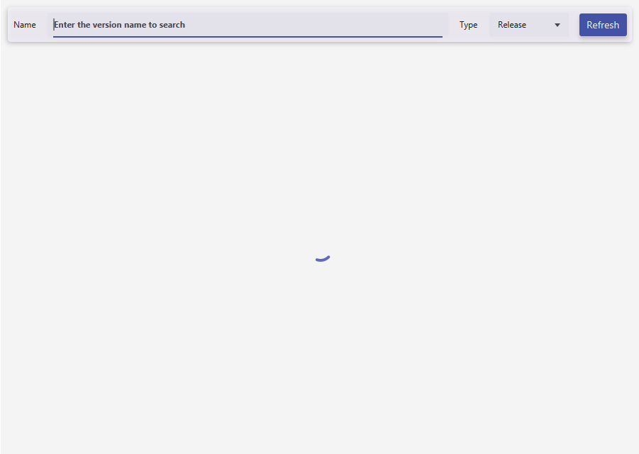
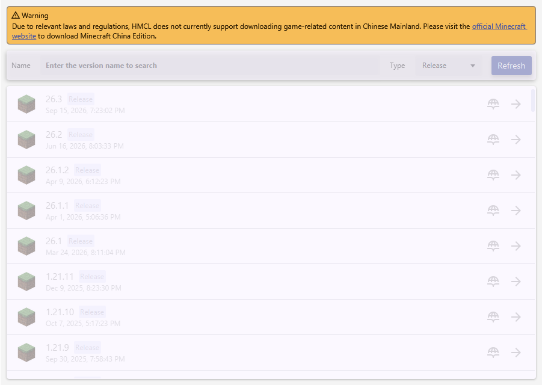

# 实际页面、下载、整合包安装与补全验证

验证日期：2026-10-20。测试在本地执行，证据随 v2 开源发布。

## 结果

| 项目 | 实际测试 | 结果 |
| --- | --- | --- |
| HMCL 下载页面 | 官方 CI JAR 的真实 `VersionsPage`，加载 103 个正式版本；上海时区的受限条件与台北时区对照 | 受限页面显示警告并禁用版本列表，台北时区页面可用 |
| HMCL 1.12.2 | 官方安装与补全任务下载客户端、34 个支持库文件、1290 个资源对象 | 完成；删除支持库后精确恢复 |
| HMCL 1.20.1 | 官方安装与补全任务下载客户端、64 个支持库文件、3575 个资源对象 | 完成；删除支持库后精确恢复 |
| PCL Modrinth 整合包 | Simply Optimized 1.20.1-12.3，Minecraft 1.20.1、Fabric 0.16.0；使用 PCL 自身下载器获取 mrpack 后导入安装 | 完成；18 个要求文件、客户端及 3575 个资源对象校验通过 |
| PCL CurseForge 整合包 | 标准格式测试包，含真实 FerriteCore Fabric 项目 459857 / 文件 4810977、Fabric 0.16.0 和 overrides 配置 | API 文件查询、模组下载、游戏安装及 overrides 复制均完成 |
| PCL 原版文件补全 | 从隔离整合包实例删除支持库与资源文件，再执行真实 `DlClientFix` | 两个文件均逐字节恢复 |
| PCL 缺失模组 | 删除整合包中的一个模组，再执行 `DlClientFix` | 不会补回该模组；测试结束后已恢复测试文件 |

**PCL 的“补全”不能理解为恢复整合包中的所有文件。已验证支持库和资源补全，缺失模组不在其原版补全范围内。** 整合包初次安装时的模组下载已通过验证。

## 页面证据

[正常下载页面](hmcl-download-enabled.png) · [受限下载页面](hmcl-download-restricted.png)





页面是官方 JavaFX 控件的实际渲染。测试读取实际 Minecraft 版本列表及其禁用状态，排除筛选下拉列表，并等待真实版本单元布局完成后截图。

## 版本与样本

HMCL：官方 CI `3.17.dev-8827fd0`，提交 `8827fd06d8ea8bcd899e54f76004f63a447e2601`。PCL：官方 `2.99.0.0` 的隔离副本，仅应用当前 Helper 补丁。

| 文件 | SHA256 |
| --- | --- |
| HMCL exe | `c7c035b77829a5e075051070562b82e9beb3cb0a0e2856510bf45409658dec4a` |
| HMCL JAR | `22c218b81be4c61962e199250d67c9b295dd8ee0e45334f96149a8a59af64862` |
| Simply Optimized mrpack | `0dee84e53d7adfe0f12c2af4a09355ab86f3150753e3448039c19db658eb3ef4` |

公开整合包来源：[Modrinth 版本 MSICaFbr](https://modrinth.com/modpack/sop/version/MSICaFbr)。CurseForge 测试使用的真实文件来源：[FerriteCore Fabric 6.0.1](https://www.curseforge.com/minecraft/mc-mods/ferritecore-fabric/files/4810977)，SHA1 为 `8fa3b84fc5860dbc30fdf8cced02af68dffcf3fa`。CurseForge 样本是测试构造的标准格式包，不冒充公开发布的整合包。

## 验证方法与边界

- HMCL 的原生 exe 参数传递已在先前反向对照中验证。本次页面和安装测试直接使用同一官方 JAR 中的页面、版本提供器、异步任务执行器、安装器与补全任务。测试仅为抽象仓库提供最小实例工厂，并使用内存中的默认主题配置。
- PCL 使用实际补丁后的官方程序集，执行自身 `NetDownloadByLoader`、`ModpackInstall` 和 `DlClientFix`。配置和缓存位于隔离目录；全局设置在测试进程内使用默认值和本地文件存储。测试宿主明确使用 .NET 4.8、TLS 1.2 和正确的长路径配置。
- 受限页面通过仅作用于测试进程的地区查询失败触发原有受限分支，随后恢复网络用于加载真实版本列表；没有修改地区判定结果。
- 校验使用官方客户端/资源元数据以及 mrpack 中的 SHA1，另用独立 Python 校验器验证落盘文件，未使用仅创建文件的模拟下载器。
- Windows 窗口自动化运行时初始化失败。本次是实际组件与真实网络下载的集成验证，未通过鼠标走完两个启动器主窗口的全部安装向导，也未登录账号或进入游戏。
- 结果只覆盖列出的 CI 版本、游戏版本和格式样本，不代表所有整合包、所有加载器或后续正式版均已验证。

## 复现

```powershell
.\tests\hmcl-e2e.ps1 -JavaHome 'JDK 目录' -HmclJar '官方 HMCL.jar'

.\tests\pcl-e2e.ps1 -PclPath '官方 PCL 2.99.0.0.exe' `
  -ModpackPath 'Simply-Optimized-1.20.1-12.3.mrpack' `
  -InstanceName helper-e2e-online `
  -DownloadUrl '该版本 API 中的 files[0].url' -Sha1 '该版本 API 中的 files[0].hashes.sha1'

.\tests\pcl-e2e.ps1 -PclPath '官方 PCL 2.99.0.0.exe' `
  -ModpackPath 'Simply-Optimized-1.20.1-12.3.mrpack' `
  -Mode repair -InstanceName helper-e2e-online

python .\tests\verify-e2e.py --minecraft '.test-data/e2e/pcl/minecraft' `
  --instance helper-e2e-online --modpack '.test-data/e2e/Simply-Optimized-1.20.1-12.3.mrpack'
```

网络下载日志与完整安装产物保留于本地 `.test-data/e2e/`，不纳入源码或软件发布包。
