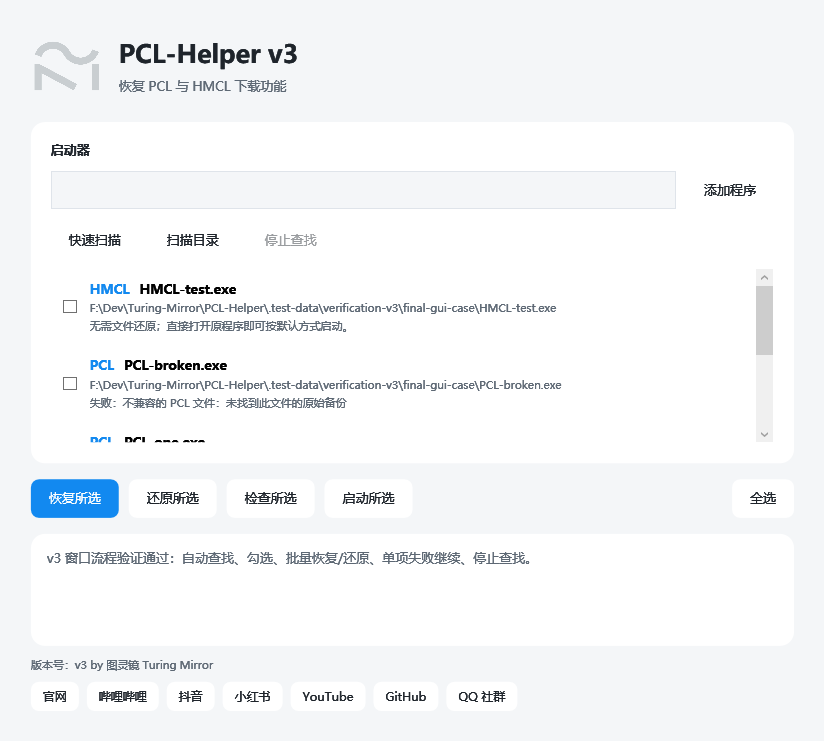

# v3：PCL 2.99.0.1 适配验证

2026-10-25 完成本地验证。v3 程序位于 `release/v3/PCL-Helper-v3.exe`，尚未发布 Release。

## 基线与恢复范围

官方源码提交：[`93ede5d9e638c99fcec853a9ba1eecd91ceee7f5`](https://github.com/Meloong-Git/PCL/commit/93ede5d9e638c99fcec853a9ba1eecd91ceee7f5)。测试程序直接提取自该提交的“最新正式版.zip”，程序集版本为 `2.99.0.1`。

原版 EXE SHA256：`0db34e19d9eeb6d496d20fabe786ec16bbd36ba6b0ccdc8d29cb7e909c114397`。

新版仍包含下载页及安装逻辑，但通过编译期常量隐藏了入口。v3 在原有修补基础上恢复自动安装导航、默认下载子页、主页无版本时的下载状态、空版本列表下载按钮、本地整合包导入，以及 Minecraft 更新提示中的下载按钮。用户主动隐藏下载页、F11 强制显示、隐藏版本查看模式的原有行为保留。

按版本选择补丁配置，继续支持 `2.99.0.0`。补丁修订号为 3；已有 v2 补丁通过经 SHA256 验证的原始备份升级。

## 实测结果

| 检查 | 结果 |
| --- | --- |
| 官方原版与恢复后真实 WPF 控件对照 | 自动安装可见性、默认子页、本地整合包导入、空版本下载按钮均符合预期 |
| 用户隐藏与 F11 强制显示 | 真实设置切换后，空版本下载按钮按原逻辑隐藏或显示；主页下载状态计算通过 |
| 隐藏版本查看模式 | 下载按钮仍隐藏 |
| CLR JIT 与页面构造 | 原有 6 个方法、新增恢复涉及的 7 个方法及下载导航构造函数全部通过；真实下载页构造通过 |
| Mojang 版本列表 | 实际 `DlClientListLoader` 联网成功，获取 1.20.1 元数据地址 |
| Modrinth 整合包 | PCL 自身下载器在线下载 Simply Optimized `1.20.1-12.3`，校验后实际安装成功，包含 Minecraft 1.20.1、Fabric 0.16.0、18 个文件与 overrides |
| CurseForge 格式样本 | 实际安装 Minecraft 1.20.1、Fabric 0.16.0、FerriteCore 6.0.1 与 overrides 成功 |
| 原版文件补全 | 两个实例均删除一个支持库和一个资源，实际 `DlClientFix` 补回后与原文件逐字节一致 |
| 独立文件校验 | 两个实例的客户端、各 3575 个唯一资源 SHA1 通过；Modrinth 清单中的 18 个文件全部通过 |
| 重复操作与还原 | 新旧两个 PCL 版本的重复修补、重复还原、重新应用、原文件 SHA256 精确还原通过 |
| v2 补丁升级 | 使用已发布 v2 程序生成旧补丁，v3 升级成功，仍可还原为最初的原文件 |
| Helper 原生 GUI | 最终交付 EXE 的 v3 标识、图标、快捷入口、扫描、多副本选择、批量操作、单项失败继续及取消扫描通过 |
| HMCL 回归 | 现有参数追加、父进程环境隔离及不修改文件的还原行为通过；本次未重跑 HMCL 游戏下载 |

FerriteCore 文件 SHA1：`8fa3b84fc5860dbc30fdf8cced02af68dffcf3fa`。

下载测试复用了之前的支持库和资源缓存；客户端、整合包及模组由真实安装任务处理，补全测试另行删除文件后重新下载。未声称将所有缓存文件重新从网络下载。

PCL 的原版文件补全仍不会恢复缺失的整合包模组：两个实例删除模组后的实测均未补回，测试结束后已恢复原模组文件。页面验证使用实际 WPF 对象和上游加载器的集成测试宿主，跳过正常启动时的单例与用户配置初始化；没有通过自动鼠标走完完整安装向导，也没有验证登录和进入游戏。

## 页面证据

以下为原版与恢复后的真实下载导航控件。右侧内容区在此独立控件截图中留空，截图用于对照左侧入口。




## 复现

```powershell
.\tests\smoke.ps1 -PclPath '原版 PCL 2.99.0.1.exe'
.\tests\pcl-navigation.ps1 -PclPath '原版 PCL 2.99.0.1.exe'
.\tests\discovery.ps1 -PclPath '原版 PCL 2.99.0.1.exe'
.\tests\gui.ps1 -PclPath '原版 PCL 2.99.0.1.exe'
.\tests\pcl-e2e.ps1 -PclPath '原版 PCL 2.99.0.1.exe' -ModpackPath '公开整合包.mrpack' -OutputDirectory '.test-data\v3-install'
```

重复验证不同 PCL 版本时使用独立输出目录。原始程序、测试副本、游戏文件、完整运行日志与构建结果均位于被忽略的本地目录，不随仓库分发。
